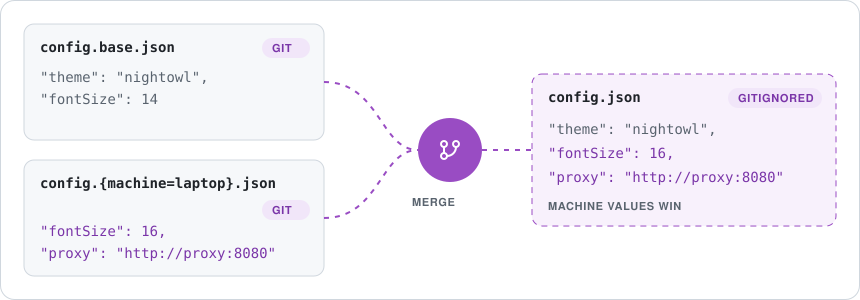
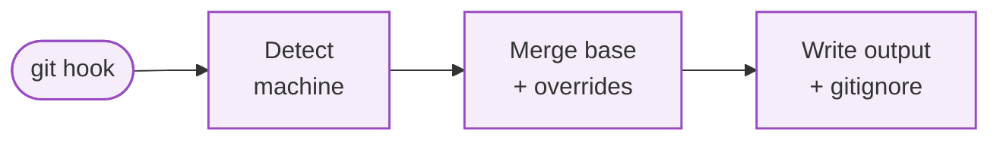

<div align="center">


# permachine

**One git repo, every machine, the right config on each.**<br>
permachine merges shared base files with per-machine overrides, for tools that have no per-machine config of their own.

<a href="https://www.npmjs.com/package/permachine"></a>
<a href="https://www.npmjs.com/package/permachine"></a>


<a href="https://github.com/JosXa/permachine/blob/main/LICENSE"></a>

[**Quick start**](#-quick-start) · [File names](#-file-names-and-filters) · [Recipes](#-recipes) · [Commands](#-commands) · [Troubleshooting](#-troubleshooting)

<br>



</div>

<br>

##  Why

You sync your dotfiles across a work laptop, a home desktop and a server. Most settings are shared, but some are not: local paths, proxies, API keys, MCP servers that exist on one machine only. Most tools read exactly one config file and have no idea which machine they run on.

permachine keeps one `base` file plus small override files in git and writes the merged result on each machine:

- **Detects the machine** by hostname, OS, CPU architecture, user and `NODE_ENV`.
- **Merges** the base file with every override that matches. Machine values win.
- **Gitignores the output** and removes it from git tracking, so merged files never get committed.
- **Runs on its own** through git hooks on checkout, merge (`git pull`) and commit.

##  Quick start

```sh
npm install -g permachine
cd ~/dotfiles
permachine init
```

That's it. From now on, every `config.base.json` is merged with the overrides for this machine into `config.json` whenever git switches, pulls or commits.

<details>
<summary>What <code>permachine init</code> prints</summary>

<br>

```text
✓ Machine detected: laptop
✓ Git hooks installed via core.hooksPath
✓ Merged 2 file(s)
✓ Added 2 file(s) to .gitignore
✓ Removed 1 file(s) from git tracking

Git hooks will auto-merge on:
  - checkout (switching branches)
  - merge (git pull/merge)
  - commit
```

`init` asks before it overwrites existing output files.

</details>

##  File names and filters

Put filters in curly braces between the name and the extension. permachine writes the output next to the input, without the filter part.

| File | In git? | Applies on |
|---|---|---|
| <code>config.<b>base</b>.json</code> | ✅ | every machine |
| <code>config.<b>{os=windows}</b>.json</code> | ✅ | Windows |
| <code>config.<b>{machine=laptop}</b>.json</code> | ✅ | the machine named `laptop` |
| <code>secrets.<b>{machine=laptop}{user=josxa}</b>.json</code> | ✅ | user `josxa` on `laptop` |
| `config.json` | ❌ gitignored | **output** |

| Filter | Values | Read from |
|---|---|---|
| `{machine=…}` | any hostname, case-insensitive | `COMPUTERNAME` on Windows, `hostname()` elsewhere |
| `{os=…}` | `windows`, `macos`, `linux` | the platform |
| `{arch=…}` | `x64`, `arm64` | the CPU |
| `{user=…}` | any user name | the current user |
| `{env=…}` | for example `prod`, `dev` | `NODE_ENV` |

Chain filters for AND: `{os=windows}{arch=x64}`. Separate values with commas for OR: `{os=windows,macos}`. The [file filters guide](https://github.com/JosXa/permachine/blob/main/docs/FILE_FILTERS.md) has the complete rules.

<details>
<summary>Legacy names: <code>config.laptop.json</code></summary>

<br>

The older syntax puts the bare machine name in the file name and still works:

| File | In git? |
|---|---|
| `config.base.json` | ✅ |
| `config.my-laptop.json` | ✅ |
| `.env.base` | ✅ |
| `.env.my-laptop` | ✅ |
| `config.json`, `.env` | ❌ output |

Prefer `{machine=my-laptop}` for new files: it says what it means, and it combines with other filters.

</details>

### Whole directories

A filter on a directory name selects the whole directory. It is copied verbatim, without merging:

<table>
<tr>
<th width="50%">In git</th>
<th width="50%">On <code>homezone</code></th>
</tr>
<tr>
<td valign="top">

```text
.opencode/skills/
  jira.{machine=homezone}/
    SKILL.md
    templates/issue.md
  work-tools.{machine=laptop}/
    slack.md
  shared-skill/
    common.md
```

</td>
<td valign="top">

```text
.opencode/skills/
  jira/            ← copied
    SKILL.md
    templates/issue.md
  shared-skill/
    common.md
```

</td>
</tr>
</table>

<details>
<summary>Directory rules</summary>

<br>

- Directories accept the same filters as files, including AND chains.
- Files inside a matched directory are copied as they are. Their names are not filtered.
- There is no base directory: `mydir.base/` has no meaning.
- Nested filtered directories, such as `outer.{machine=x}/inner.{os=y}/`, are an error.
- Two directories that would produce the same output are an error.
- A stale output directory is renamed with a `.permachine-deleted` suffix, never deleted.

</details>

##  Supported file types

| Type | Files | Merge |
|---|---|---|
| JSON | `.json` | Deep merge. Machine values override base values. |
| JSONC | `.json`, `.jsonc` with comments and trailing commas | Deep merge. Comments are kept. |
| ENV | `.env`, `.env.*` | Key upsert. Comments are kept. |
| Markdown | `.md`, `.markdown` | Base text, then the machine text appended. |

Other files are not merged. YAML ([#1](https://github.com/JosXa/permachine/issues/1)) and TOML ([#2](https://github.com/JosXa/permachine/issues/2)) are planned, and patch files ([#4](https://github.com/JosXa/permachine/issues/4)) are proposed.

##  Recipes

### VS Code settings per machine

```jsonc
// .vscode/settings.base.json
{ "editor.fontSize": 14, "workbench.colorTheme": "Dark+" }

// .vscode/settings.{machine=worklaptop}.json
{
  "http.proxy": "http://proxy.company.com:8080",
  "terminal.integrated.cwd": "C:/Projects/Work"
}
```

On `worklaptop`, `.vscode/settings.json` gets all four settings. Add `settings.{machine=desktop}.json` for the next machine.

### MCP servers that exist on one machine only

[OpenCode](https://opencode.ai) reads one `opencode.json`. Keep the shared parts in the base file and switch servers on or off per machine:

<table>
<tr>
<td width="50%" valign="top">

```jsonc
// opencode.base.json
{
  "$schema": "https://opencode.ai/config.json",
  "theme": "nightowl-transparent",
  "mcp": {
    "telegram": {
      "type": "local",
      "command": ["uvx", "telegram-mcp"],
      "enabled": false
    }
  }
}
```

</td>
<td width="50%" valign="top">

```jsonc
// opencode.{machine=homezone}.json
{
  "mcp": {
    "telegram": { "enabled": true }
  }
}
```

Deep merge keeps `type` and `command` from the base file and changes only `enabled`.

</td>
</tr>
</table>

### Scripts per operating system

```jsonc
// package.base.json
{ "name": "my-app", "scripts": { "test": "vitest" } }

// package.{os=macos,linux}.json
{ "scripts": { "open": "open http://localhost:3000" } }

// package.{os=windows}.json
{ "scripts": { "open": "start http://localhost:3000" } }
```

### Secrets per machine and user

```text
.env.base                               # shared defaults: ports, feature flags
.env.{machine=work}{user=alice}         # Alice's keys on the work machine
.env.{machine=home}{user=alice}         # Alice's keys at home
.env                                    ← output, gitignored
```

Variables from the override replace the same keys from the base file. Everything else, including comments, stays.

### Agent instructions per machine

Markdown files are appended, so a machine can add instructions on top of the shared ones:

```text
AGENTS.base.md                    # shared rules for every machine
AGENTS.{machine=homezone}.md      # "Projects live in /projects. Use the GPU for local models."
AGENTS.md                         ← base text, then the homezone text
```

### Skills that exist on one machine

Use [directory filters](#whole-directories): `skills/jira.{machine=work}/` appears as `skills/jira/` on the work machine only.

##  How it works



A checkout, pull or commit runs the hook.

Hooks live in `.permachine/hooks` and are activated through `core.hooksPath`. `permachine init --legacy` wraps existing hooks in `.git/hooks` instead, for repositories that already use Husky or another hook manager.

##  Commands

| Command | Does |
|---|---|
| `permachine init` | Installs the hooks, merges once and updates `.gitignore`. |
| `permachine merge` | Merges now. Asks before it overwrites existing output. |
| `permachine watch` | Merges whenever you save a watched base or override file. |
| `permachine info` | Shows the machine name, hook setup and tracked patterns. |
| `permachine uninstall` | Removes the hooks. |

<details>
<summary>All options</summary>

<br>

| Option | For | Effect |
|---|---|---|
| `--silent`, `-s` | `merge` | Print errors only. |
| `--legacy` | `init` | Wrap `.git/hooks` instead of setting `core.hooksPath`. |
| `--auto` | `init` | Choose the hook method automatically. |
| `--no-gitignore` | `init`, `merge` | Leave `.gitignore` and git tracking alone. |
| `--debounce <ms>` | `watch` | Wait this long after a change. Default `300`. |
| `--verbose` | `watch` | Print every file change event. |
| `--help`, `-h` / `--version`, `-v` | all | Help / version. |

```text
$ permachine info
Machine name: laptop
Repository: /path/to/repo
Hooks method: core.hooksPath
Hooks path: .permachine/hooks
Tracked patterns: 2
  - config.base.json + config.laptop.json → config.json
  - .env.base + .env.laptop → .env

Output files: 2 total, 1 existing
Existing output files:
  - config.json
```

</details>

##  Troubleshooting

<details>
<summary><b>Nothing merges after a pull</b></summary>

<br>

Check that the hooks are active:

```sh
git config --get core.hooksPath   # expect .permachine/hooks
ls .permachine/hooks/
```

Then run `permachine merge` by hand to see errors.

</details>

<details>
<summary><b>My override file is ignored</b></summary>

<br>

Compare the name in your file with the detected machine name:

```sh
permachine info   # "Machine name: …"
hostname          # echo %COMPUTERNAME% on Windows
```

Names are case-insensitive. Also check the [supported file types](#-supported-file-types): permachine skips files it cannot merge.

</details>

<details>
<summary><b>I already use Husky or another hook manager</b></summary>

<br>

```sh
permachine uninstall
permachine init --legacy
```

Legacy mode wraps the existing hooks instead of replacing them.

</details>

<details>
<summary><b>The output file still shows up in git</b></summary>

<br>

`init` and `merge` add outputs to `.gitignore` unless you passed `--no-gitignore`. To fix one file by hand:

```sh
echo "config.json" >> .gitignore
git rm --cached config.json
```

`git ls-files config.json` prints nothing once the file is untracked.

</details>

##  Roadmap

- [x] JSON, JSONC, ENV and Markdown merging
- [x] Git hooks through `core.hooksPath` or legacy wrapping, plus `.gitignore` management
- [x] Watch mode and directory filters
- [ ] YAML support ([#1](https://github.com/JosXa/permachine/issues/1))
- [ ] TOML support ([#2](https://github.com/JosXa/permachine/issues/2))
- [ ] Patch files ([#4](https://github.com/JosXa/permachine/issues/4))
- [ ] Custom merge strategies ([#5](https://github.com/JosXa/permachine/issues/5))
- [ ] Config file for patterns ([#6](https://github.com/JosXa/permachine/issues/6))
- [ ] Dry-run mode ([#7](https://github.com/JosXa/permachine/issues/7))

##  Contributing

[CONTRIBUTING.md](https://github.com/JosXa/permachine/blob/main/CONTRIBUTING.md) covers the development setup, architecture, tests and code standards. Hook handling is inspired by [Husky](https://github.com/typicode/husky).

##  License

[MIT](https://github.com/JosXa/permachine/blob/main/LICENSE) © [JosXa](https://github.com/JosXa)
